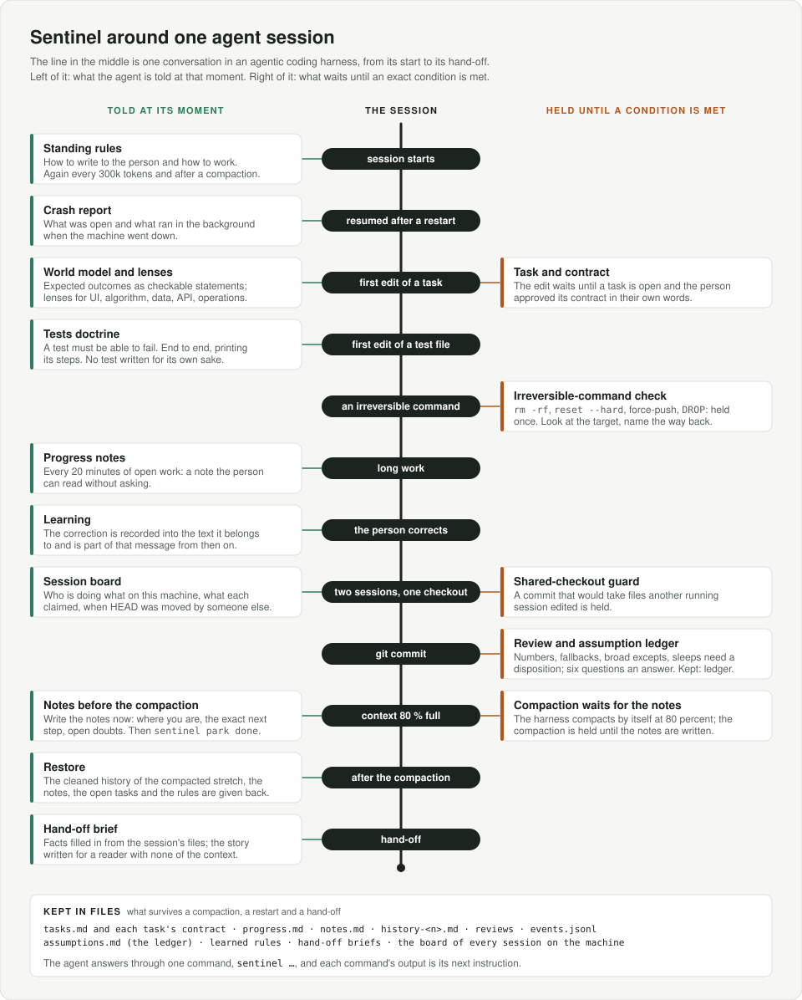

# Sentinel

Sentinel is a discipline layer for agentic coding harnesses: the programs in which a language model reads a
repository, runs commands and edits files on a person's behalf, such as Claude Code or OpenHands.

It does not make the agent smarter. It does three things around the agent's work. It gives the agent the right
message at the moment that message applies. It checks with code the things code can check exactly, and holds an
action until the check passes. And it keeps the working state of a session in files, so that a compaction, a restart
or a hand-off does not lose it.

Sentinel runs on Claude Code today. The part that speaks to the harness is small and separate from the flows, so
another harness can be added; [Other harnesses](#other-harnesses) says what that takes and where OpenHands stands.



**Contents:** [The problem](#the-problem-it-answers) · [How it works](#how-it-works) ·
[The flows](#what-it-does-flow-by-flow) · [Install](#install-and-activate) · [Settings](#settings) ·
[Commands](#commands) · [Files](#what-it-keeps-on-disk) · [Changing and extending](#changing-and-extending-it) ·
[Limits](#limits-to-know) · [Development](#development-and-tests)

The design and its reasons are in [docs/SPEC.md](docs/SPEC.md). What was tested, how, and what the tests changed is
in [docs/TESTING.md](docs/TESTING.md).

## The problem it answers

Anyone who has run long agent sessions has met these moments:

- The agent starts editing before it has understood what was asked. The misunderstanding shows when the work is done.
- A number, a fallback value or a broad `except` goes into the code. Someone chose it, silently, and nobody was told.
- The context fills up and is compacted. The agent goes on with a summary that lost the detail that mattered.
- A command that cannot be undone runs before anyone has looked at what it will hit.
- Two sessions work in one checkout, and one of them commits the other's half-done files.
- The person comes back after an hour and has to ask where things stand.
- The person corrects the agent, and three hours later it makes the same mistake.
- The machine restarts, and nobody knows what was open or what was running.

A longer system prompt does not solve these. A rule that is repeated with every message has faded from view by the
time it applies. Sentinel rests on three ideas instead:

1. **A rule arrives at its moment.** A short set of standing rules is given at the start. Everything else comes when
   it applies: the contract before a task's first edit, the review before a commit, the check before an irreversible
   command, the notes before a compaction.
2. **Code checks exact conditions; the agent judges.** A hook never guesses intent from words. It checks facts such as
   "an approved task is open", "every flagged line has a disposition", "this exact command was acknowledged". What a
   good contract or a good answer is stays with the agent and the person.
3. **State lives in files.** Tasks, contracts, progress notes, reviews and the agent's own notes are files the person
   can read and a compacted or restarted session can read back.

## How it works

Sentinel has three parts, and each flow is built from them.

**The hook.** The harness calls one command, `sentinel-hook`, at each of its events: a session starts, the person
sends a message, a tool is about to run, a tool has run, the turn ends, the context is about to be compacted. The hook
records the event in the session's log, lets every enabled flow answer, and gives the harness one merged answer: some
context to add to the conversation, a refusal with its reason, or nothing. In a repository where Sentinel is not
active the hook exits at once. An error inside the hook never blocks the session: it is written to
`~/.sentinel/errors.log` and the session goes on.

**The command.** The agent answers through `sentinel <command>`, run in its shell: it opens a task, records an
approval, sets a review answer, writes a progress note. Each command prints what happened and what to do next, so an
instruction is found at the place it is used. A call that holds only `sentinel` commands, one or several, passes
without a permission prompt. A call with anything else chained, piped or substituted into it does not, and the
commands that set Sentinel up never do.

**The files.** A session's state is not kept in memory or in a database. Every event is appended to
`events.jsonl` in the session's folder, and the state is read from that log, so two hooks that run side by side cannot
overwrite each other. Beside the log stand the files written for people: the task index and contracts, the progress
notes, the agent's notes, the reviews.

A flow that holds an action does it the same way every time. The action is refused once. The refusal says why and
names the command that lifts it. Nothing is held on a guess, and nothing is held twice for the same reason.

Every message the agent receives is a Markdown file that you can read and replace, and every flow has its own switch
in one settings file.

## What it does, flow by flow

The flows follow a session from its start to its hand-off, in the order of the picture above. Each one names its
switch in `.sentinel/config.toml`.

### Standing rules — `[rules]`

A short text of nine rules, in two groups. How to write to the person: in the language of their last message, in
plain complete sentences, with established terms kept. How to work: get the context first, do not treat the person as
the expert of the area, bring assumptions and chosen numbers to the surface, prefer the robust way, send long
commands to the background, keep the progress file current, record corrections.

The agent gets it when a session starts, resumes or is cleared, after every compaction, and again each time the
context has grown by `remind_every_tokens` (300,000 by default). It is deliberately short: everything that belongs to
one moment is delivered at that moment by the flows below.

### Crash report — `[crash]`

When the machine restarts, the sessions that were open are cut without a word. Sentinel knows which ones: a session
whose log does not end with its own end, and whose last entry is older than the machine's last boot.

When such a session is resumed, the agent is told once what it was doing: its last activity, its open tasks, the
commands that ran in the background, its last progress note, and where its notes are. A new session in the same
repository is told once about the sessions that were cut, so their work is not forgotten.

### Task and contract before the first edit — `[tasks]`

This is the flow that keeps the agent from building the wrong thing well.

The first time the agent tries to edit a file, the edit is refused: no task is open. The agent opens one with
`sentinel task open "<title>"` and gets a contract to fill in: its understanding of the request, the scope, the
options with their trade-offs, its assumptions, its open questions, a world model, and how the work will be proven.
A task opened as `large` also states what else the change touches and how it is undone. The agent presents the
contract in the conversation, sized to the task, and waits.

The approval is checked, not trusted. `sentinel task approve T1 --basis "<the person's words>"` passes only when
every section has content, the person has written a message after the contract was opened, and the quoted words are
found in what they wrote. The agent cannot approve its own contract in the turn it wrote it, nor on words nobody said.
This rule came from the first real run, in which the model wrote a good contract and then approved it itself.

Three things keep this from being heavy:

- **Small work.** A task opened with `--size trivial` has no contract and no wait.
- **Steps.** A step of an approved task (`--parent T1`) is covered by that task's contract.
- **"Do not wait for me."** When you said so beforehand, the agent approves with `--standing "<your words>"`. The
  task is recorded as approved on a standing instruction, and the agent is told to put the contract in its final
  message so that you still read it. `standing = false` closes this path.

`sentinel task done T1` closes a task; the next edit needs a new one. Files under `.sentinel/`, files outside the
repository and the paths you list in `exempt` never need a task. `gate = false` keeps the tracking and drops the wait.

### World model, lenses and field note — `[tasks]`

The contract's World model section is where the agent thinks before it builds. It writes down the outcomes it
expects as statements that can be checked later: what the user will see, what a caller will get back, what the data
will look like, what else will change. The review at commit time asks what was observed for each of them.

Lenses help the agent take the right seat. `sentinel lens` lists them and `sentinel lens ui` prints one: the person
at the screen, an algorithm worked by hand on real inputs, stored data that outlives the code, an interface seen by
its callers, a service on a machine at three in the morning, a text read by another agent.

When standards or prior art could change the design, the contract tells the agent to propose a field note. Only after
you agree does it start a subagent that researches the question and returns a short note with its sources.
`world_model`, `field_note` and `proof` each have their own switch.

### Tests doctrine — `[testing]`

Agents write tests that cannot fail, and many of them. At the first edit of a test file in a task the agent is given
the doctrine: a test must be able to fail, an end-to-end test that prints what it did is worth more than ten that
restate the code, and no test is written for its own sake. A manual check that is run and recorded is a valid proof.

The review backs this with facts: a test that asserts nothing, a skipped test, an assertion on a mock call and a
test that depends on today's date are flagged, and the review states whether a test command ran after the last edit
to the code.

### Check before an irreversible command — `[gate]`

A table of patterns covers the commands that cannot be undone: a recursive delete in its Unix and PowerShell forms,
a bulk delete through `find` or `xargs`, `git reset --hard`, `git clean`, a force-push, a branch delete, a discard of
uncommitted changes, container volumes removed, SQL that drops or empties a table, access rights changed for a whole
tree, processes killed by name, disk tools, cloud resources deleted.

Such a command is refused once, with a token. The agent looks at the target, then records what it saw and how the
action is undone: `sentinel gate ok <token> --target "<what is there>" --rollback "<the way back, or why there is
none>"`. The same command then passes once. The acknowledgement belongs to the destructive part of the command and to
the place it runs in: a harmless command chained after it may change, another folder or another target may not.

This is a tripwire that makes the agent look at the moment it is about to act. It is not a sandbox; the harness's own
permission modes remain the boundary.

### Progress notes — `[progress]`

`sentinel progress "<note>"` adds a dated note to the session's `progress.md`, written for you in your language: what
is done, what is running, what comes next, what waits for you. While a task that is not trivial is open, the agent is
reminded when `every_minutes` (20) have passed since its last note. You follow long work by reading one file, without
asking.

### Learning from corrections — `[learn]`

When you correct how the agent works, or say "from now on", the standing rules tell it to record that:
`sentinel learn "<rule>" --incident "<what happened>"`. The rule is appended to the text it belongs to: the standing
rules by default, or the contract, the review, the tests doctrine or the notes before a compaction (`--where`). From
then on it is part of that message, for this repository or for all of them (`--scope project|user`).

`sentinel rules` shows the texts with what was learned; `sentinel unlearn <id>` removes an entry. The message before a
compaction asks once more for corrections not yet recorded, because that is the last moment before they are lost.

### Session board, claims and the shared checkout — `[board]`

`sentinel board` shows every session on the machine: its repository and branch, whether it is working, idle or
waiting for you, its task, its last progress note, what it claimed and what it runs in the background.

Three things protect sessions from each other:

- **Claims.** `sentinel claim <resource> "<note>"` marks a shared thing as in use: a container project, a port, an
  image tag, a server. Another session whose command names it is warned, with the note.
- **The commit guard.** A `git commit` that would take files another running session edited is refused with the
  list, unless the command names its own files (`git commit --only … -- <files>`). A `git add` earlier in the same
  command counts.
- **HEAD moved.** When the repository's `HEAD` is not where this session last saw it, and this session did not move
  it, the agent is told the range before it relies on what it read earlier.

### Review before a commit, and the assumption ledger — `[review]`

A `git commit` is the moment at which silent choices become history. Sentinel holds it for a review of the files this
session changed.

Detectors read the lines the change adds and flag exact patterns: a number someone chose, a default or fallback
value, a broad `except`, a fixed sleep, a timeout or retry count, a cut at a fixed size, a silenced check, a
hard-coded path or address, a `TODO`, and the weak tests named above. Each flagged line needs a disposition:
`sentinel review set F3 fixed`, or `sentinel review set F3 kept "<why this value is right>"`.

For a task that is not trivial the agent also answers six questions: does the change do what the contract says and
nothing else; what was observed for each expected outcome; which cases are not handled; which entries of the
fragile-pattern catalogue apply (`sentinel catalogue`); where this differs from usual practice; and what exactly
shows that it works.

The commit passes when nothing is open. Every line that was kept goes to `.sentinel/assumptions.md` with its reason,
file, date and task, and the agent is told to say these to you. The ledger is the answer to "who decided this number,
and why", months later.

### Automatic compaction that waits for the notes — `[context]`

A compaction replaces the conversation with a summary. What the agent knew and had not written down is gone.
Sentinel sets when the compaction comes and makes it wait until the agent has written its notes. You set nothing.

- **The trigger.** `sentinel init` writes `compact_at_percent` (80) into the harness's settings, so it compacts by
  itself when the context is that full. A percent fits every window size.
- **The hold.** The harness asks the hook before each automatic compaction. The first time, Sentinel answers "not
  now" and tells the agent: bring your notes up to date (where you are, the exact next step, what runs in the
  background, open doubts, what no file holds yet), then run `sentinel park done`. That command is refused while the
  notes file is unchanged. The harness asks again before every request, and Sentinel lets the compaction go when the
  notes are written.
- **The ways out.** The hold also ends by itself when the context reaches `hold_until_percent` (90), when a request
  did not get through, or when the context's size cannot be read. It is never applied to a compaction you start
  yourself, and it cannot keep a session from compacting.

`/sentinel-park` gives the same list on demand, before a compaction you start yourself.

### Restore after a compaction — `[context]`

When the compaction runs, the hook adds instructions to the summary: keep the person's instructions and corrections
in their own words, the current task and its exact next step, every open question, and names, paths and numbers as
they are.

Right after it, Sentinel writes the cleaned history of the stretch that was compacted (your messages, the agent's,
its tool calls without their outputs) and tells the agent to recover before doing anything else: read the last part
of that history, its notes, the open tasks with their contracts and the progress file, and check again anything it
only remembers. The standing rules follow. You no longer paste a recovery message after each compaction.

### Hand-off brief — `[handoff]`

`sentinel handoff --for "<reader>"` (or `/sentinel-handoff`) prepares a brief for another session or another machine.
Sentinel fills in the facts from the session's files and from git: the tasks and their state, the progress notes,
the commits made since the session started, the files edited, the claims, the path of the cleaned history. The agent
writes the three parts that need judgement, for a reader who has none of its context: what happened and what was
decided, what to read and in which order, and what is half done with its next step.

## Install and activate

Sentinel needs Python 3.11 or newer and has no dependencies.

```
uv tool install <this repository>      # once per machine: puts `sentinel` and `sentinel-hook` on PATH
cd <your repository>
sentinel init                          # activates Sentinel in this repository
sentinel doctor                        # checks the setup and times one hook call
```

`sentinel init` does four things:

1. It writes `.sentinel/config.toml`. The presence of this file is what activates Sentinel in the repository.
2. It registers the hook command for the harness's events in `.claude/settings.json`, beside whatever is there.
3. It sets the automatic compaction to `compact_at_percent` in the same file.
4. It adds four short skills (`/sentinel-park`, `/sentinel-handoff`, `/sentinel-review`, `/sentinel-board`) and the
   field-note subagent under `.claude/`.

Sessions that start in the repository after that use Sentinel; sessions already open, and other repositories, are
not touched. `sentinel uninstall` takes out the hook, the compaction setting it wrote and those files, and leaves
your data in `.sentinel/`.

Two things to decide when you activate it:

- **Shared or local.** `.claude/settings.json` is usually committed, so everyone who works in the repository gets the
  hook, and needs Sentinel installed. `sentinel init --local` writes to `.claude/settings.local.json` instead and
  keeps it on your machine.
- **Run it again after changing `compact_at_percent`**, because that value lives in the harness's settings.
  `sentinel doctor` tells you when the two do not agree.

## The panel in the editor

`extensions/vscode/` holds a small read-only panel for Cursor and VS Code. It sits in the right side bar and shows,
for every session of the workspace, what the agent wrote for you: its progress notes, its contracts with their status
and the words they were approved on, its commit reviews, and the repository's assumption ledger and hand-off briefs,
each part collapsible and refreshed as the agents write. A session whose contract waits for your answer is marked, so
you see which agent waits for you without going through the conversations. Its README says how to build and install
it.

## Settings

One file, `.sentinel/config.toml`, written by `sentinel init` with every value and the reason for it. A file of the
same shape at `~/.sentinel/config.toml` sets your defaults for every repository; the repository's file overrides it.
`sentinel config` prints the values in force.

| Section | What it switches | Settings |
|---|---|---|
| `[rules]` | the standing rules | `remind_every_tokens` (300000) |
| `[learn]` | recording corrections | |
| `[tasks]` | tasks and the contract | `gate`, `standing`, `exempt`, `world_model`, `field_note`, `proof`, `[tasks.sections]` (the contract's sections for each size) |
| `[testing]` | the tests doctrine and the test facts | `test_globs`, `commands` (what counts as a test run) |
| `[gate]` | the check before irreversible commands | `disable`, `[[gate.patterns]]` |
| `[progress]` | the progress reminder | `every_minutes` (20) |
| `[board]` | the board, claims and the commit guard | `stale_after_hours` (24) |
| `[review]` | the review and the ledger | `skip`, `disable`, `ignore_numbers`, `[[review.patterns]]` |
| `[context]` | the compaction, the notes and the restore | `compact_at_percent` (80), `hold_until_percent` (90), `park_at_tokens` (0: off), `recent_fraction` (0.25) |
| `[crash]` | the crash report | |
| `[handoff]` | the hand-off brief | `dir` |

Every section has `enabled`. A flow that is off gives no message, holds nothing, and its lines disappear from the
other texts.

## Commands

For the agent, in a session:

| Command | What it does |
|---|---|
| `sentinel task open "<title>" [--size trivial\|normal\|large] [--parent T1]` | opens a task and prints its contract |
| `sentinel task approve [T1] --basis "<words>"` or `--standing "<words>"` | records the person's approval |
| `sentinel task done [T1]`, `sentinel task list` | closes a task; lists them |
| `sentinel lens [name]` | the lenses for the world model |
| `sentinel review`, `review set F<n> fixed\|kept "<reason>"`, `review answer <n> "<text>"`, `review status` | the review before a commit |
| `sentinel catalogue` | the fragile patterns: in how work is done, and in code |
| `sentinel gate ok <token> --target "…" --rollback "…"` | acknowledges a held irreversible command |
| `sentinel progress "<note>"` | adds a progress note for the person |
| `sentinel learn "<rule>" --incident "…" [--where …] [--scope …]`, `unlearn <id>`, `rules` | corrections |
| `sentinel claim <resource> "<note>"`, `release <resource>` | claims on shared resources |
| `sentinel park`, `sentinel park done` | the notes before a compaction |
| `sentinel handoff [--for "<reader>"]` | a hand-off brief |

For you, in a terminal:

| Command | What it does |
|---|---|
| `sentinel init [--local]`, `uninstall`, `doctor` | set up, take out, check |
| `sentinel board [--all]` | every session on this machine |
| `sentinel status` | what Sentinel did in a session: messages given, reviews, acknowledgements, compactions |
| `sentinel config` | the settings in force |
| `sentinel transcript <file>` | the cleaned history of any session transcript |

## What it keeps on disk

```
<repository>/.sentinel/
  config.toml              the settings; its presence activates Sentinel here
  assumptions.md           the ledger: every flagged line that was kept, with its reason
  texts/  learned/         this repository's own texts and learned rules
  handoff/                 hand-off briefs
  sessions/<id>/           one folder for each session (ignored by git)
    events.jsonl           everything that happened, append-only; the state is read from it
    tasks.md  tasks/T1.md  the task index and each task's contract
    progress.md            the notes for the person
    notes.md               the agent's own notes for after a compaction
    reviews/R1.md          the reviews before commits
    history-1.md           the cleaned history written at each compaction

~/.sentinel/
  config.toml              your defaults for every repository
  texts/  learned/         your own texts and learned rules
  modules/                 your private flows
  board/                   one small file for each session on this machine
  errors.log               hook errors, if any
```

`config.toml`, `assumptions.md`, `texts/` and `learned/` are meant to be committed; the sessions folder is not.

## Changing and extending it

From the lightest change to the heaviest.

### Change what the agent is told

Every message is a Markdown file under `src/sentinel/texts/`: the standing rules, each moment's message, the review
questions, the catalogue, the lenses, the contract's sections. To replace one, put a file with the same path under
`.sentinel/texts/` in the repository, or under `~/.sentinel/texts/` for all your repositories. The repository's file
wins over yours, and yours over the package's.

Two conventions are used in these files. `{name}` is a place Sentinel fills in (a path, a task id). A line that ends
with `<!-- if:learn -->` is given only while that flow is on, and `<!-- if:tasks.field_note -->` only while that
setting is true.

### Teach it instead of editing

Most changes do not need a file edit. A correction recorded with `sentinel learn` is appended to the text it belongs
to and survives upgrades of the package. Use `--scope user` for a rule about how you work everywhere, and
`--scope project` for a rule of one repository.

### Add a detector or a pattern

A review detector and an irreversible-command pattern are entries in the settings file:

```toml
[[review.patterns]]
name = "print-debug"
regex = "\\bprint\\("
why = "a debug print left in"

[[gate.patterns]]
name = "prod-deploy"
regex = "deploy\\.sh\\s+prod"
why = "deploys to production"
```

`disable = ["numeric-literal"]` switches a built-in detector off, `ignore_numbers` lists the numbers that are not
worth a question in your code, and `skip` lists the files the review leaves out.

### Change the contract, add a lens

The contract's sections for each task size are a list in `[tasks.sections]`, and each section is a small template in
`texts/templates/sections/`. Remove a section you do not want, or add one by adding its template and its name. A lens
is one file in `texts/lenses/`; a new file there appears in `sentinel lens`.

### Add a flow

A flow is one Python file with three things: its section name in the settings, handlers named after the events it
cares about, and optionally its commands.

```python
"""Reminds the agent to update the changelog when it edits the public API."""
SECTION = "changelog"

def on_post_tool_use(ctx, out):
    path = ctx.rel(ctx.tin.get("file_path", "")) or ""
    if path.startswith("src/api/") and not ctx.session.last("changelog_asked"):
        ctx.session.log("changelog_asked")
        out.context("You changed the public API. Add a line to CHANGELOG.md before you commit.")
```

Put it in `~/.sentinel/modules/` and switch it on with `[changelog]` `enabled = true`; nothing in the package
changes. A handler can add context (`out.context`), refuse a tool call with its reason (`out.deny`), and record
events in the session's log, from which it reads its own state. The built-in flows in `src/sentinel/modules/` are
written the same way and are the examples to read; to ship a flow with the package, add its file there and its name
to the list in `modules/__init__.py`.

### Other harnesses

The flows, the command, the session files and the texts know nothing about a particular harness. Five small pieces
do, and they are what an adapter for another harness supplies:

| Piece | Where it is today | What it does |
|---|---|---|
| Events in | `hook.py` | reads one event as the harness sends it: its name, the tool and its input, the session, the transcript's path |
| Answer out | `core.Out.render` | writes the merged answer in the form the harness takes: context to add, a refusal, an allowance |
| Setup | `install.py` | registers the hook in the harness's settings and writes the skills |
| Transcript | `transcript.py` | reads the conversation for the context's size, the cleaned history and the person's own words |
| Compaction | `modules/context.py` | names the setting that triggers the compaction and the event that can hold it |

A flow whose event a harness does not have simply does not fire there; the others work unchanged.

**Claude Code** is the harness all of this was built and tested on (version 2.1.310).

**OpenHands** is the nearest second one. Its documentation describes hooks read from `.openhands/hooks.json`, with
`PreToolUse`, `PostToolUse` and `UserPromptSubmit` among its events, in a format it calls compatible with Claude
Code's. The flows that hold an action (the task gate, the irreversible-command check, the review, the commit guard)
are built on those three events. No adapter has been written or run for it yet, so read this as the plan, not as
support.

## Limits to know

- **Tripwires, not a sandbox.** The pattern tables read a command's text. They make the agent look and say; they do
  not replace the harness's permission modes.
- **Edits through the shell** (`sed -i`, a script that writes files) do not pass the task gate; edits through the
  harness's edit tools do.
- **Your own commits** in a terminal are not seen: the review and the commit guard act on the agent's commands.
- **Cost.** One hook call takes about 200 milliseconds on Windows, and the harness calls the hook before and after a
  tool call. `sentinel doctor` measures it on your machine.
- **Tested on** Windows 11 with Claude Code 2.1.310, in headless sessions. The macOS code paths exist and have not
  been run; neither has the VS Code extension.
- **The compaction hold** depends on how the harness treats a compaction that a hook blocks. In Claude Code 2.1.310 it
  is skipped quietly and tried again before the next request; this was read in its code and seen in a real run. A
  later version could change that, and the hold's ways out are there so that it could only ever end early.

## Development and tests

```
uv sync
uv run pytest tests -o addopts="" -q            # the automated tests
uv run python tests/behaviour/run.py <repo> "<prompt>"   # one real turn of a harness session, with what Sentinel did
python docs/diagram.py                          # writes docs/overview.svg again after a flow changes
```

The automated tests drive Sentinel the way the harness and the agent do: events go into the hook's own entry
function and commands into the CLI's, each test in a real git repository of its own. The behavioural tests run a real
session against a scratch repository and record what the model did with each message; they are where the approval
rule, the shared-checkout guard and the compaction hold were proven, and several of them changed the design.
[docs/TESTING.md](docs/TESTING.md) has the full record, including what has not been tested.
